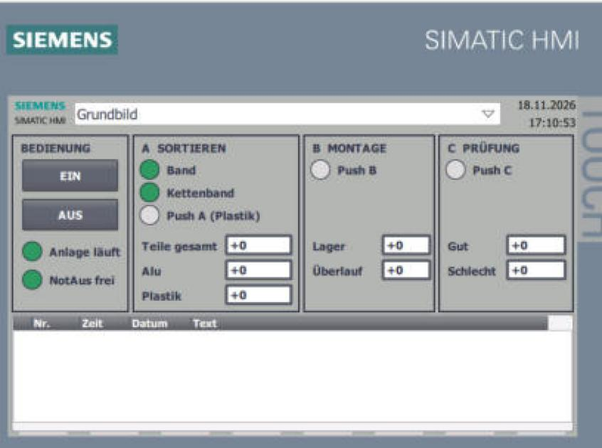
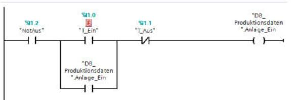
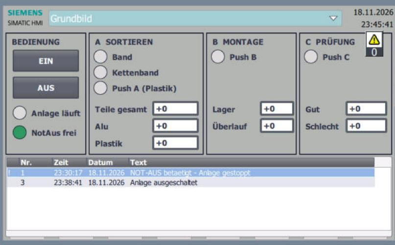

# Montageanlage V18 – SPS-Steuerung mit S7-1500 und HMI

Steuerung einer Lern-Montageanlage mit **Siemens S7-1500** in **TIA Portal V18**:
Teile werden sortiert (Bereich A), Ringe werden montiert (Bereich B) und fertige Teile werden geprüft und aussortiert (Bereich C).
Bedient und beobachtet wird die Anlage über ein **KTP700 Basic Panel** (WinCC Basic) mit Statusanzeige, Produktionszählern und Störmeldungen.
Die Steuerung wurde im Labor am realen Aufbau getestet; HMI und Störmeldungen in **S7-PLCSIM V18** und der **WinCC-Runtime-Simulation**.

---

## Inhalt
- [Überblick](#überblick)
- [Hardware](#hardware)
- [Ein- und Ausgänge](#ein--und-ausgänge)
- [Programmaufbau](#programmaufbau)
- [Ablauf der drei Bereiche](#ablauf-der-drei-bereiche)
- [HMI und Störmeldungen](#hmi-und-störmeldungen)
- [Test](#test)
- [Annahmen im Programm](#annahmen-im-programm)
- [Projektkontext und eigener Anteil](#projektkontext-und-eigener-anteil)
- [Dateien](#dateien)

---

## Überblick

| Bereich | Aufgabe |
|---|---|
| **A – Sortieren** | Teile auf dem Band erkennen (Alu oder Plastik). Plastikringe mit Push A ins Zwischenlager schieben, Teile zählen, Überlauf erkennen, wenn das Lager voll ist. |
| **B – Montage** | Wenn die Montagevorrichtung frei ist und Ringe im Lager sind, gibt Push B einen Ring frei (Impuls 500 ms). Der Lagerzähler wird heruntergezählt. |
| **C – Prüfung** | Ein kapazitiver Sensor prüft, ob der Ring richtig montiert ist. Gutteile werden gezählt, Schlechtteile mit Push C ausgeworfen und gezählt. |

Ein- und ausgeschaltet wird die Anlage über Taster (T_Ein / T_Aus) oder über das HMI. Der NOT-AUS ist als Öffner angeschlossen und sperrt die Anlage.

## Hardware

| Komponente | Typ |
|---|---|
| CPU | S7-1500, CPU 1511-1 PN (6ES7511-1AL03-0AB0, FW 3.0) |
| Digitaleingänge | DI 16x24VDC BA |
| Digitalausgänge | DQ 16x24VDC/0,5A BA |
| HMI | KTP700 Basic PN (6AV2 123-2GB03-0AX0) |
| Kommunikation | PROFINET (PN/IE_1), HMI-Verbindung CPU ↔ Panel |
| Software | TIA Portal V18, S7-PLCSIM V18, WinCC Basic |

## Ein- und Ausgänge

**Eingänge (11)**

| Symbol | Adresse | Bedeutung |
|---|---|---|
| AluPlast | %I0.0 | Teil erkannt (Alu oder Plastik) |
| Alu | %I0.1 | Teil ist aus Alu |
| SensB | %I0.2 | Montagevorrichtung belegt |
| SensC_Push | %I0.3 | Teil am Pusher C |
| SensC_Kap | %I0.4 | Sensor Bereich C (im Programm nicht verwendet) |
| LS | %I0.5 | Lichtschranke (im Programm nicht verwendet) |
| Kapazitiv | %I0.6 | Prüfung: Ring richtig montiert |
| Induktiv | %I0.7 | induktiver Sensor (im Programm nicht verwendet) |
| T_Ein | %I1.0 | Taster EIN |
| T_Aus | %I1.1 | Taster AUS |
| NotAus | %I1.2 | NOT-AUS (Öffner: 1 = frei, 0 = betätigt) |

**Ausgänge (5)**

| Symbol | Adresse | Bedeutung |
|---|---|---|
| Push_A | %Q0.0 | Pusher A: Plastikring ins Zwischenlager |
| Push_B | %Q0.1 | Drehmagnet B: Ring zur Montage freigeben |
| Push_C | %Q0.2 | Pusher C: Schlechtteil auswerfen |
| Kettenband | %Q0.3 | Kettenband |
| Band | %Q0.4 | Förderband |

## Programmaufbau

- **OB1 „Main“** (zyklisch), 15 Netzwerke, gemischt **KOP** und **SCL**
- **DB1 „DB_Produktionsdaten“** (global): Betriebszustand, Zähler, Flankenmerker, Timer (TP_TIME) und HMI-Variablen

| NW | Sprache | Inhalt |
|---|---|---|
| 1 | KOP | Ein/Aus mit **Selbsthaltung**: NotAus – (T_Ein ODER Anlage_Ein) – NICHT T_Aus → Anlage_Ein |
| 2 | SCL | Bedienung über HMI (EIN/AUS) und **Meldebits** für die Störmeldungen → [Code](OB1_NW02_HMI_Bedienung_Meldungen.scl) |
| 3–4 | KOP | Band und Kettenband laufen, solange Anlage_Ein = 1 |
| 5–6 | KOP | Einschaltflanke: Zähler beim Start auf 0 setzen (MOVE) |
| 7 | KOP | Push_A für Plastikteile, mit Vergleicher *Lager < Zwischenlager_Max* |
| 8–12 | KOP | Flankenauswertung der Sensoren, Teile zählen (INC), Plastik = Gesamt − Alu (SUB) |
| 13 | SCL | Bereich A: Zwischenlager hochzählen, Überlauf zählen → [Code](OB1_NW13_Bereich_A_Zwischenlager.scl) |
| 14 | SCL | Bereich B: Ring freigeben (TP 500 ms), Lager herunterzählen → [Code](OB1_NW14_Bereich_B_Montage.scl) |
| 15 | SCL | Bereich C: Prüfergebnis merken, Gut/Schlecht zählen, Schlechtteil auswerfen → [Code](OB1_NW15_Bereich_C_Pruefung.scl) |

**Netzwerk 1 – Selbsthaltung mit NOT-AUS (KOP):**

Verwendete Techniken: Selbsthaltung, NOT-AUS als Öffner, positive und negative Flanken mit „Vorher“-Merkern, Impulszeiten (TP), Vergleicher, Zähler im globalen DB.

## Ablauf der drei Bereiche

**Bereich A – Sortieren**
1. Ein Teil erreicht den Sensor (Flanke AluPlast) → *Teile gesamt* + 1.
2. Bei Alu → *Alu* + 1. *Plastik* ergibt sich aus Gesamt − Alu.
3. Plastikteil und Lager nicht voll → Push A schiebt das Teil ins Zwischenlager → *Lager* + 1.
4. Lager voll (Lager ≥ Zwischenlager_Max) → Push A bleibt aus → *Überlauf* + 1.

**Bereich B – Montage**
1. Montagevorrichtung leer (SensB = 0) und Lager > 0 → Push B gibt für 500 ms einen Ring frei.
2. Flanke Push B → *Lager* − 1.
3. Der TP startet erst neu, wenn die Bedingung zwischendurch weggefallen ist, also nur einmal pro Teil.

**Bereich C – Prüfung**
1. Der kapazitive Sensor meldet „Ring richtig montiert“ → Merker *Gut*.
2. Das Teil erreicht den Pusher (Flanke SensC_Push) → *Gut* + 1 oder *Schlecht* + 1.
3. Schlechtteil → Push C wirft es für 500 ms aus.
4. Das Teil verlässt den Pusher (negative Flanke) → Merker wird zurückgesetzt.

## HMI und Störmeldungen

Das Grundbild ist in vier Spalten aufgeteilt, entsprechend dem Aufbau der Anlage:

| BEDIENUNG | A SORTIEREN | B MONTAGE | C PRÜFUNG |
|---|---|---|---|
| EIN / AUS, Anlage läuft, NotAus frei | Band, Kettenband, Push A, Teile gesamt / Alu / Plastik | Push B, Lager, Überlauf | Push C, Gut, Schlecht |

- Schaltflächen EIN/AUS mit „SetzeBitWährendTasteGedrückt“
- Statuslampen über die Animation „Gestaltung“ (grau = aus, grün = ein; NotAus rot = betätigt)
- Zähler als Ausgabefelder aus DB1

**Störmeldungen:** Die SPS entscheidet, *wann* eine Störung vorliegt, das HMI zeigt den Text dazu an.

| Bit in `HMI_Meldungen` (Word) | Bedingung in der SPS | Meldetext | Meldeklasse |
|---|---|---|---|
| 0 | `NOT NotAus` | NOT-AUS betaetigt – Anlage gestoppt | Errors (quittierpflichtig) |
| 1 | `MB_Rutsche >= Zwischenlager_Max` | Zwischenlager voll – Push A gesperrt | Warnings |
| 2 | `NOT Anlage_Ein` | Anlage ausgeschaltet | Warnings |

## Test

Getestet in S7-PLCSIM V18 (Eingänge über die SIM-Tabelle) zusammen mit der WinCC-Runtime-Simulation. Ausführliches Protokoll: [Testprotokoll.md](Testprotokoll.md)

| Test | Ergebnis |
|---|---|
| Start über Taster und HMI, Selbsthaltung, Aus über Taster und HMI | ✅ |
| NOT-AUS sperrt den Start und stoppt die Anlage im Betrieb | ✅ |
| Bereich A: Sortieren, Zähler, Zwischenlager bis 4, Überlauf | ✅ |
| Bereich B: Ring freigeben, Lager − 1 | ✅ |
| Bereich C: Gut/Schlecht zählen, Push C | ✅ |
| HMI: Lampen, Zähler, Bedienung | ✅ |
| Meldungen „NOT-AUS betaetigt“ und „Anlage ausgeschaltet“ | ✅ |

Die Steuerung der Bereiche A, B und C wurde im Labor am realen Aufbau getestet und hat funktioniert. HMI und Störmeldungen sind bisher in der Simulation getestet.

## Annahmen im Programm

- Das Zwischenlager fasst 4 Ringe (`Zwischenlager_Max = 4`, Testwert)
- AluPlast und Alu schalten bei einem Aluteil gleichzeitig
- Der kapazitive Sensor kommt vor SensC_Push
- 500 ms reichen für Push B und Push C
- Der Lagerzähler startet bei 0
- SensC_Kap, LS und Induktiv werden nicht verwendet

## Projektkontext und eigener Anteil

Laborprojekt aus dem Studium (Automatisierungstechnik).
- Steuerung der Bereiche A, B und C selbstständig erstellt und **im Labor am realen Aufbau erfolgreich getestet**.
- HMI und Störmeldesystem in der Simulation getestet.
- **Inbetriebnahme und Test** des gesamten Programms und HMI in PLCSIM und WinCC-Simulation, inklusive Fehlersuche.

Die Aufgabenstellung der Hochschule ist nicht Teil dieses Repositorys.

## Dateien

| Datei | Inhalt |
|---|---|
| README.md | diese Projektbeschreibung |
| Testprotokoll.md | alle Tests mit Eingaben, Erwartung und Ergebnis |
| OB1_NW02_HMI_Bedienung_Meldungen.scl | SCL-Code Netzwerk 2: HMI-Bedienung und Meldebits |
| OB1_NW13_Bereich_A_Zwischenlager.scl | SCL-Code Netzwerk 13: Zwischenlager und Überlauf |
| OB1_NW14_Bereich_B_Montage.scl | SCL-Code Netzwerk 14: Bereich B |
| OB1_NW15_Bereich_C_Pruefung.scl | SCL-Code Netzwerk 15: Bereich C |
| hmi_betrieb.jpg, hmi_meldungen.jpg | HMI-Bilder aus der Simulation |
| kop_nw1_selbsthaltung.jpg | KOP-Netzwerk 1 |

Die SCL-Dateien sind Auszüge der SCL-Netzwerke aus OB1. Die KOP-Netzwerke sind im TIA-Projekt enthalten.
